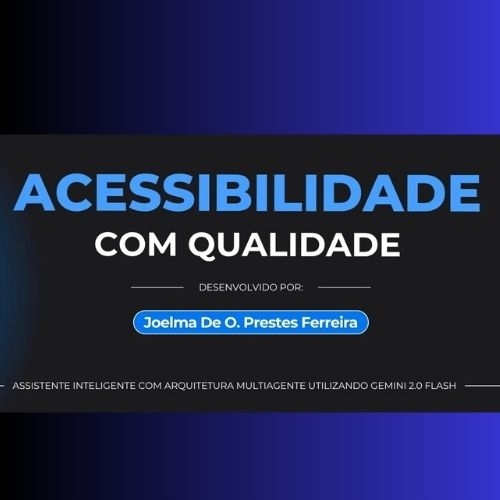

# 🖼️ Guia de Otimização de Imagens

Este guia explica como otimizar as imagens do projeto para melhor performance.

## 📊 Status Atual

### ✅ Imagens já em WebP
- `assets/img/banner.webp`
- `assets/img/multimind-banner.webp`
- `assets/img/perfil.webp`
- `assets/img/thumbnail/estante.webp`
- `assets/img/thumbnail/floricultura.webp`
- `assets/img/thumbnail/mario.webp`
- `assets/img/thumbnail/cartao.webp`
- `assets/img/thumbnail/placeholder.webp`

### ⚠️ Imagens que precisam ser convertidas

#### 1. JPG para WebP
- `assets/img/thumbnail/multimind-thumbnail.jpg` → `multimind-thumbnail.webp`

#### 2. PNG para WebP (ou SVG quando aplicável)
- `assets/img/mario-jump/clouds.png` → `clouds.webp`
- `assets/img/mario-jump/game-over.png` → `game-over.webp`
- `assets/img/mario-jump/pipe.png` → `pipe.webp`
- `assets/img/body.jpg` → `body.webp` (se ainda não convertido)

#### 3. PNG para SVG (ícones)
- `assets/img/github.png` → `github.svg` (recomendado para ícones)
- `assets/img/linkedin.png` → `linkedin.svg` (recomendado para ícones)

## 🛠️ Ferramentas de Conversão

### Opção 1: Usando ImageMagick (CLI)

```bash
# Instalar ImageMagick (macOS)
brew install imagemagick

# Converter JPG para WebP
convert assets/img/thumbnail/multimind-thumbnail.jpg -quality 85 assets/img/thumbnail/multimind-thumbnail.webp

# Converter PNG para WebP
convert assets/img/mario-jump/clouds.png -quality 85 assets/img/mario-jump/clouds.webp
convert assets/img/mario-jump/game-over.png -quality 85 assets/img/mario-jump/game-over.webp
convert assets/img/mario-jump/pipe.png -quality 85 assets/img/mario-jump/pipe.webp
```

### Opção 2: Usando cwebp (Google WebP)

```bash
# Instalar (macOS)
brew install webp

# Converter JPG para WebP
cwebp -q 85 assets/img/thumbnail/multimind-thumbnail.jpg -o assets/img/thumbnail/multimind-thumbnail.webp

# Converter PNG para WebP
cwebp -q 85 assets/img/mario-jump/clouds.png -o assets/img/mario-jump/clouds.webp
```

### Opção 3: Usando Ferramentas Online

1. **Squoosh** - https://squoosh.app/
   - Arraste e solte a imagem
   - Escolha WebP
   - Ajuste qualidade (recomendado: 80-85)
   - Baixe e substitua

2. **CloudConvert** - https://cloudconvert.com/
   - Upload da imagem
   - Escolha WebP como formato de saída
   - Baixe e substitua

### Opção 4: Usando Node.js (se tiver package.json)

```bash
# Instalar sharp
npm install --save-dev sharp

# Script de conversão (criar convert-images.js)
const sharp = require('sharp');
const fs = require('fs');
const path = require('path');

const images = [
  'assets/img/thumbnail/multimind-thumbnail.jpg',
  'assets/img/mario-jump/clouds.png',
  'assets/img/mario-jump/game-over.png',
  'assets/img/mario-jump/pipe.png'
];

images.forEach(img => {
  const input = path.join(__dirname, img);
  const output = input.replace(/\.(jpg|png)$/i, '.webp');
  
  sharp(input)
    .webp({ quality: 85 })
    .toFile(output)
    .then(() => console.log(`✅ Convertido: ${output}`))
    .catch(err => console.error(`❌ Erro em ${input}:`, err));
});
```

## 📝 Após Conversão

### 1. Atualizar Referências no Código

Após converter as imagens, atualize as referências nos arquivos HTML:

```html
<!-- Antes -->


<!-- Depois -->

```

### 2. Arquivos a Atualizar

- `index.html` - linha 221
- `projetos/mario/mario.html` - referências às imagens do jogo
- Verificar outros arquivos HTML que usam essas imagens

### 3. Remover Imagens Antigas (Opcional)

Após confirmar que tudo funciona:

```bash
# Remover JPG/PNG antigos (cuidado!)
rm assets/img/thumbnail/multimind-thumbnail.jpg
rm assets/img/mario-jump/*.png
```

## 🎯 Benefícios da Conversão

- **Redução de tamanho:** WebP é ~25-35% menor que JPG/PNG
- **Melhor performance:** Páginas carregam mais rápido
- **SEO:** Google favorece sites mais rápidos
- **Experiência do usuário:** Menos tempo de carregamento

## 📊 Tamanhos Esperados

| Arquivo Original | Tamanho Estimado | Tamanho WebP (85%) | Economia |
|----------------|------------------|-------------------|----------|
| multimind-thumbnail.jpg | ~50-100 KB | ~35-70 KB | ~30% |
| clouds.png | ~20-50 KB | ~15-35 KB | ~30% |
| game-over.png | ~10-30 KB | ~7-20 KB | ~30% |
| pipe.png | ~5-15 KB | ~3-10 KB | ~30% |

## ✅ Checklist

- [ ] Converter `multimind-thumbnail.jpg` para WebP
- [ ] Converter imagens PNG do Mario Jump para WebP
- [ ] Atualizar referências nos arquivos HTML
- [ ] Testar todas as páginas
- [ ] Verificar se as imagens carregam corretamente
- [ ] Remover imagens antigas (opcional)
- [ ] Fazer commit das alterações

---

**Última Atualização:** 2025-11-26

